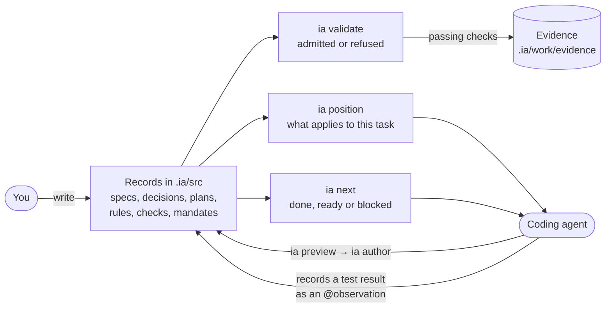

# How IA works

**IA lets you write down what a project has decided, requires, plans and allows, as small typed records stored next to the code. It checks those records, and hands each person or agent the part that applies to the work in front of them.**

This page is the whole picture in plain language. The [walkthrough](walkthrough.md) then follows one piece of work through it, and the concept pages look closer at each part.

## The problem

A project's important knowledge is scattered: a requirement in a ticket, a decision in a chat thread, a rule in someone's head, the plan in a document nobody updates. A new teammate has to piece it together. A coding agent starts every task knowing none of it, unless someone pastes the right parts into a prompt.

Two more things go wrong:

- **Prose cannot be checked.** A document can say a task depends on a decision that was never made, or point at a requirement that was deleted, and nothing notices.
- **"Done" is a claim.** An agent that says "I ran the tests and they pass" may be right. But the statement is not evidence, and it says nothing about which version of the work it covers.

IA addresses each of these.

## The pieces

### Records

A record is one block of text in a `.ia` file under your repository's `.ia/src/` folder:

```ia
@decision list-format
  meaning
    says "Choose the file format of an exported shopping list."
  work
    title "Shopping-list file format"
    status made
  decision
    question "Which file format does the export produce?"
    choice "Markdown checklist"
```

`@decision` is the **word**: it says what kind of record this is. `list-format` is its **name**, and other records refer to it as `@decision list-format`. The rest are fields, grouped in sections.

Records are plain text. They live in git, appear in diffs and get reviewed with the code. [Records](records.md) covers the syntax.

### Words and systems

IA comes with a vocabulary of 44 words. Each word has a **schema** that says which fields a record must and may have, and which values are allowed. Some examples:

| To write down | Use |
| --- | --- |
| A requirement | `@spec` |
| A question and its answer | `@decision` |
| Work to do | `@plan`, `@milestone`, `@task` |
| A rule | `@law`, `@principle`, `@convention` |
| How to do something | `@playbook` |
| A requirement IA can check | `@contract`, `@case`, `@check` |
| Something that was observed, such as a test result | `@observation` |
| Who acts, and what they may do | `@agent`, `@mandate` |

Words are grouped into **systems**. `work-system` owns the planning words, `governance-system` owns the rule words, and so on: eleven systems in all. You can define words of your own in a system of your own. [Words and systems](words-and-systems.md) explains the vocabulary.

### The workspace

`ia init` turns a repository into a **workspace**. It creates the `.ia/` folder, installs the language, and writes three starter records: the `@workspace`, an `@agent` for the coding agent that works here, and a `@mandate` saying what that agent may do. [Workspaces](workspaces.md) covers the files and what to commit.

### The checker

`ia validate` reads every record and checks it against its word's schema. It checks that every reference points at a record that exists, and that every relationship is one the words allow. The result is either **Admitted** or **Refused**, with each problem named by file, line, record and rule:

```text
  ✖  .ia/src/shopping-list.ia:71
     work-system/definition/task/document-export
     IA-COMP-FIELD-VALUE  'work.status' admits one of proposed, open, held,
     closed, dropped, superseded; found "done"
```

The same checker runs in the VS Code extension as you type, and in CI.

### Plans and evidence

Plans, milestones and tasks link to each other and to the decisions they wait on. `ia next` reads those links and tells you, for each task, whether it is **done**, **ready** or **blocked**, and why:

```text
  ▲  work-system/definition/task/add-export-button
     blocked (task work-system/definition/task/write-exporter: no exit evidence)
```

A task counts as done only when an `@observation` records a successful check of that exact version of the task. Its `status` field is a label for people; IA prints it but never relies on it. [Planning work](planning-work.md) explains the rules.

### Rules and checks

Rules (`@law`, `@principle`, `@convention`) say what must hold. IA does not run your code to enforce them. It makes sure they reach whoever works on a matching record. A blocking law is always part of an agent's starting context.

Checks are different: a `@check` names an **evaluator** that IA runs during `ia validate`. The built-in evaluators check records: schemas, references, coverage. A passing check writes its result to disk as evidence. A check whose evaluator did not run reports **not-evaluated**, and IA never counts that as a pass. See [Rules](rules.md) and [Checks and evidence](checks-and-evidence.md).

### Agents, mandates and positions

An agent starts a task by asking IA for its **position**:

```sh
ia position --seat work-system/definition/task/write-exporter --shape sequence
```

The answer is a short, ordered summary of what bears on that task: the task, what depends on it, the decision it rests on, the rules that apply and the mandate the agent works under. It is computed from the records alone, so the same question always gets the same answer, with a digest to prove it.

A `@mandate` lists the **moves** an agent may make: observe, verify, write records, delegate, change things. IA's own commands refuse a move the mandate does not allow. This is a guard rail for well-behaved agents, not security: anyone who can edit `.ia/src/` can change a mandate. Agents write records through `ia preview` and `ia author`, which show an edit first and then apply exactly that edit, signed with who made it. See [Agents and authority](agents-and-authority.md).

### Hosts

`ia host claude` or `ia host codex` connects the workspace to Claude Code or Codex. It writes a generated **position packet**, a summary the agent loads at startup that tells it to start from `ia position`. It also writes an authoring skill and registers a read-only MCP server the agent can query. For Claude Code, agent profiles and edit guards you describe in records are generated too. See [Connecting agents](connecting-agents.md).

### Distributions

Vocabulary is packaged and shared as **distributions**: versioned archives of records. The language itself is one, bundled with the CLI and installed by `ia init`. You can package your own words, rules and methods the same way, publish them to a registry and install them in other workspaces. See [Distributions and kits](distributions-and-kits.md).

## The whole picture



Read it as one loop:

1. **You write down** the requirement, the decisions, the plan and the rules as records.
2. **IA checks** them: every record well formed, every reference real.
3. **IA orders the work.** `ia next` shows what can start and what waits on what.
4. **An agent starts from its position.** It gets the task, its context, the rules and its mandate, and nothing it does not need.
5. **The agent works** and changes records through the governed path.
6. **Results become evidence.** A test result, a review or a passing check is recorded against the exact version of the work it covers.
7. **`ia next` moves on** only when that evidence exists.

## What IA does not do

- **It is not a task tracker or a CI system.** It has no server or user interface. It reads files and prints results; you run it on your machine or in CI.
- **It does not run your tests or inspect your code.** It records results you give it and checks records.
- **It is not a sandbox or an access control system.** Mandates restrict IA's own commands and, optionally, an agent's file edits through a hook. Real permissions come from your host, your operating system and your repository settings.
- **It ships no method.** IA defines what records mean and what a result establishes. How your team plans, reviews or designs is yours to write down, as playbooks, rules and checks in your own words.

[What a result means](what-results-mean.md) lists exactly what each IA result does and does not establish.

## Next

- Follow [the walkthrough](walkthrough.md) to build a small workspace and see each piece work.
- Look up unfamiliar terms in the [glossary](glossary.md).
